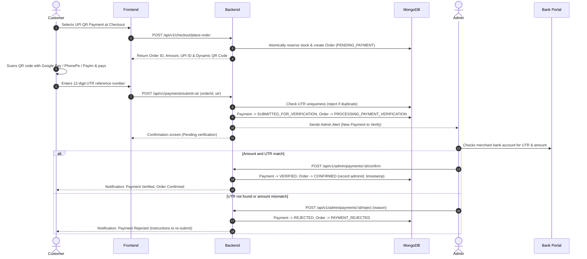

# Backend Integration Plan: Secure E-commerce Platform for Organic Products Website

## 1. Executive Summary & Objective

This document outlines the end-to-end integration architecture to transform the existing GVKSS Organic Products frontend into a production-grade, secure, multi-tier e-commerce system. 

The existing frontend provides rich UI components, bilingual support (English and Telugu), responsive design, and cart state in `localStorage`. The backend will provide:
- Strict server-side security, rate limiting, and RBAC authentication.
- A normalized, indexed, transactional MongoDB Atlas database managed via Mongoose ODM.
- Complete lifecycle management for products, categories, inventory, carts, and orders.
- Manual UPI QR-code verification (customer UTR submission -> admin banking audit -> verification/rejection) with duplicate replay protection.
- Cash on Delivery (COD) with configurable limits and pincode eligibility.
- Dedicated, secure Admin Dashboard with role-based access control.
- Transactional email notifications and comprehensive automated testing.

---

## 2. Existing Frontend Architecture Analysis

### 2.1 Framework & Core Libraries
- **Bundler & Tooling**: Vite 8.2 + TypeScript 6.0.
- **UI Framework**: React 19.2 (Functional components, Hooks).
- **Styling**: Tailwind CSS 3.4 with custom theme tokens, animations (`animate-pop-out-down`, `animate-fadeIn`, `foodie` shadows), and responsive utilities.
- **Icons & Effects**: `lucide-react`, `canvas-confetti`.
- **Linter**: `oxlint`.

### 2.2 Routing & Navigation Structure
- Currently a Single Page Application (SPA) utilizing view-state switching via `activeTab` inside `src/App.tsx`:
  - `home`: Landing page containing Hero, BalancedDietSection, OrganicProcessShowcase, CategoryGrid, FeaturedPacks, ReadyToCookPromo, ReadyToEatPromo, NaturalProductsShowcase, TrustSection, HomeDeliveryBanner.
  - `shop`: Full catalog browsing with `ProductFilters` (category, price range, stock, featured, sorting) and `ProductGrid`.
  - `categories`: Standalone category catalog.
  - `monthly-pack`: Curated grocery pack bundles (42-item family pack, etc.).
  - `ready-to-cook`: Sprouted flours, millet semiya, instant mixes.
  - `natural-products`: Desi Cow A2 milk, bilona ghee, honey.
  - `about`: Institutional history, farmer collectives, DDS Sangham story.
  - `contact`: Branch locations, phone helplines, consultation details.
- Header and Footer orchestrate tab switching and category navigation.

### 2.3 Existing State Management
- **`LanguageContext`**: Manages language state (`'en' | 'te'`) and UI strings from `translations.ts`.
- **`CartContext`**: Client-side cart backed by `localStorage` (`'sangham_cart'`). Provides `addToCart`, `addMonthlyPack`, `removeFromCart`, `updateQuantity`, `clearCart`, `cartCount`, and `subtotal`.
- **Local State in `App.tsx`**: Modals for Product Details (`ProductModal`), Search (`SearchModal`), Checkout (`CheckoutModal`), and Order Receipt (`OrderReceipt`).

### 2.4 Existing Product & Pack Data
- **Data Source**: Static arrays in `src/data/products.ts` (100+ items across 11 categories: millets, rice, flours, pulses, oils, spices, ready-to-cook, ready-to-eat, natural-dairy, sweets-snacks, herbal-eco).
- **Monthly Packs**: Defined in `src/data/monthlyPacks.ts` with sub-items, weight, and pricing.
- **Pricing & Inventory**: Currently hardcoded, prices calculated on client side, stock checked only via boolean `available`.

### 2.5 Existing Checkout & Order Flow
- **`CheckoutModal.tsx`**: Collects name, phone, email, address, city, pincode, delivery notes.
- Calculates delivery fee (₹0 if subtotal ≥ ₹1000, else ₹50).
- Payment method radio selector (`cod`, `upi`, `card`).
- When placed: generates random `SNG-xxxxxx` order ID on client side, triggers confetti, passes order object to `OrderReceipt.tsx`, clears local cart.
- No backend persistence, no real UPI verification, no authentication requirement.

---

## 3. Required Database Architecture (MongoDB Atlas & Mongoose)

All data models will be implemented in TypeScript using Mongoose ODM with strict schema validation, unique indexes, audit timestamps, and transactional integrity.

### 3.1 Required Collections (24 Models)
1. **`User`**: Customer profile (name, email, passwordHash, phone, isVerified, verificationToken, passwordResetToken, status: active/suspended, timestamps).
2. **`Admin`**: Admin operators with RBAC role references, MFA configuration (TOTP secret, MFA enabled), failed login tracking.
3. **`Role`**: Role definitions (`SUPER_ADMIN`, `ADMIN`, `ORDER_MANAGER`, `PAYMENT_VERIFIER`, `INVENTORY_MANAGER`).
4. **`Permission`**: Granular permissions (e.g., `orders:read`, `orders:write`, `payments:verify`, `products:write`, `inventory:adjust`, `settings:write`).
5. **`UserSession`**: Rotating refresh tokens, hashed tokens, device user-agent, IP address, expiration date, revoked status, TTL index.
6. **`Address`**: Saved customer delivery addresses (userId, fullName, phone, streetAddress, areaLocality, city, state, pinCode, landmark, isDefault).
7. **`Category`**: Product categories (slug/id, nameEn, nameTe, icon, descriptionEn, descriptionTe, image, badge, benefitEn, benefitTe, sortOrder, isActive).
8. **`Product`**: Master products (sku, nameEn, nameTe, slug, categoryId, subCategory, price, discountedPrice, quantityUnit, unit, image, additionalImages, descriptionEn, descriptionTe, ingredients, nutritionalInfo, organicCertDetails, isReadyToCook, isReadyToEat, isFeatured, isNaturalProduct, tags, source, status: active/inactive/draft, softDeleted).
9. **`ProductImage`**: Stored media assets, CDN URLs, alt text, primary flag.
10. **`Inventory`**: Stock records per SKU (productId, currentStock, reservedStock, minThreshold, lowStockAlertTriggered, reorderLevel).
11. **`Cart`**: Persistent customer carts (userId, status: active/abandoned/converted, updatedAt).
12. **`CartItem`**: Normalized cart items (cartId, productId, quantity, priceSnapshot).
13. **`Order`**: Master orders (orderNumber e.g. `GVKSS-YYYYMMDD-XXXX`, customerId, guestEmail, guestPhone, shippingAddressSnapshot, itemsSubtotal, discountAmount, deliveryFee, totalPayableAmount, paymentMethod: `UPI` | `COD`, paymentStatus, orderStatus, cancelReason, trackingNumber, courierName, notes).
14. **`OrderItem`**: Immutable line items captured at checkout (orderId, productId, sku, productNameEn, productNameTe, unitPack, unitPrice, quantity, lineTotal).
15. **`Payment`**: Payment record linked to order (orderId, paymentMethod: `UPI` | `COD`, amount, currency: `INR`, status: `PENDING` | `SUBMITTED_FOR_VERIFICATION` | `VERIFIED` | `REJECTED` | `COD_PENDING` | `PAID` | `REFUNDED`, utrNumber, submittedAt, verifiedAt, rejectedAt, rejectionReason, verifiedByAdminId).
16. **`PaymentVerification`**: Audit log of verification attempts, duplicate UTR checks, verification notes.
17. **`OrderStatusHistory`**: Immutable log of order state transitions (orderId, fromStatus, toStatus, changedBy: userId/adminId/system, reason, timestamp).
18. **`Coupon`**: Promotional discounts (code, discountType: percentage/flat, value, minOrderValue, maxDiscount, validFrom, validTo, usageLimit, isActive).
19. **`CouponUsage`**: Records coupon redemption per user/order.
20. **`Review`**: Customer reviews & ratings (productId, customerId, rating, comment, isApproved).
21. **`Shipping`**: Courier integration and tracking status (orderId, carrier, trackingNumber, status, dispatchDate, estimatedDelivery).
22. **`Notification`**: Notification log (recipientEmail, type, templateId, metadata, sentStatus, errorLog).
23. **`StoreSettings`**: Singleton store configuration:
    - Business name, contact phones, address, support email.
    - UPI details: `businessUpiId`, `businessDisplayName`, `qrCodeImageUrl`, `paymentInstructions`.
    - Delivery configuration: `freeDeliveryThreshold` (₹1000 default), `standardDeliveryFee` (₹50 default), distance tiers.
    - COD configuration: `isCodEnabled`, `codMinOrderAmount`, `codMaxOrderAmount`, `eligiblePinCodes` (allowlist/denylist).
    - Payment verification deadline in minutes (e.g., 60 mins before auto-cancellation).
24. **`AuditLog`**: Security and administrative audit trail (adminId, action, targetResource, targetId, ipAddress, userAgent, details, timestamp).

### 3.2 Database Integrity & Indexes
- **Unique Indexes**:
  - `User.email`
  - `Admin.email`
  - `Product.sku` & `Product.slug`
  - `Order.orderNumber`
  - `Payment.utrNumber` (Sparse unique index to strictly prevent duplicate UTR submissions across orders)
- **TTL Indexes**:
  - `UserSession.expiresAt` (Automatic session purge)
  - `User.verificationTokenExpiresAt` & `passwordResetExpiresAt`
- **Transactions & Concurrency**:
  - MongoDB replica set session transactions (`session.withTransaction`) for checkout and payment verification.
  - Stock decrements implemented atomically with conditional updates:
    ```typescript
    Inventory.findOneAndUpdate(
      { productId, currentStock: { $gte: quantity } },
      { $inc: { currentStock: -quantity, reservedStock: quantity } },
      { session, new: true }
    )
    ```

---

## 4. Required Backend API Endpoints

### 4.1 Authentication & Profile (`/api/v1/auth`, `/api/v1/users`)
- `POST /api/v1/auth/register`: Customer account creation (name, email, password, phone). Sends verification email.
- `POST /api/v1/auth/login`: Customer email/password login. Issues JWT access token (Bearer or HttpOnly cookie) + secure rotating refresh token.
- `POST /api/v1/auth/refresh-token`: Rotates refresh token and issues new access token.
- `POST /api/v1/auth/logout`: Revokes current refresh token session.
- `POST /api/v1/auth/forgot-password`: Generates secure, expiring password reset link.
- `POST /api/v1/auth/reset-password`: Resets password using token.
- `GET /api/v1/auth/verify-email/:token`: Validates customer email.
- `GET /api/v1/users/me`: Retrieves authenticated customer profile and active addresses.
- `PUT /api/v1/users/me`: Updates customer profile.
- `GET /api/v1/addresses`: Customer saved delivery addresses.
- `POST /api/v1/addresses`: Create new delivery address.
- `PUT /api/v1/addresses/:id`: Edit delivery address.
- `DELETE /api/v1/addresses/:id`: Remove delivery address.

### 4.2 Products & Catalog (`/api/v1/products`, `/api/v1/categories`)
- `GET /api/v1/categories`: Public list of active categories.
- `GET /api/v1/products`: Public paginated, filtered, and sorted products (filters: category, price min/max, inStock, featured, readyToCook, readyToEat, query search).
- `GET /api/v1/products/:idOrSlug`: Product details with real-time stock availability.
- `GET /api/v1/products/featured`: Featured bundles and products for home showcase.
- `GET /api/v1/products/monthly-packs`: Monthly provision pack bundles.

### 4.3 Shopping Cart (`/api/v1/cart`)
- `GET /api/v1/cart`: Fetch persistent cart for authenticated customer, with server-computed prices and real-time stock checks.
- `POST /api/v1/cart/items`: Add item to cart with stock validation.
- `PUT /api/v1/cart/items/:productId`: Update item quantity.
- `DELETE /api/v1/cart/items/:productId`: Remove item from cart.
- `DELETE /api/v1/cart`: Clear cart.
- `POST /api/v1/cart/sync`: Merge guest cart (`localStorage`) into authenticated cart upon login.

### 4.4 Checkout & Orders (`/api/v1/checkout`, `/api/v1/orders`)
- `POST /api/v1/checkout/calculate`: Independently calculates subtotal, discounts, shipping charges, and total payable amount from database prices.
- `POST /api/v1/checkout/place-order`: Creates order using a database transaction.
  - Validates authentication.
  - Validates address and PIN code eligibility.
  - Locks and decrements inventory atomically.
  - Stores immutable snapshots of items and prices.
  - Generates unique order number.
  - If paymentMethod is `UPI`, creates Payment with status `PENDING`.
  - If paymentMethod is `COD`, verifies COD eligibility and creates Payment with status `COD_PENDING`.
- `GET /api/v1/orders/my-orders`: Paginated order history for customer.
- `GET /api/v1/orders/:orderNumber`: Order details, status history, and receipt details.
- `POST /api/v1/orders/:orderNumber/cancel`: Customer cancellation (permitted only before confirmation/packing).

### 4.5 Payments & UPI Verification (`/api/v1/payments`)
- `GET /api/v1/payments/upi-info`: Returns business UPI ID, merchant display name, and QR code image URL for order amount.
- `POST /api/v1/payments/submit-utr`: Customer submits UTR for a pending UPI order:
  - Validates 12-digit UTR regex / format.
  - Rejects if UTR already exists in `Payment` collection (duplicate detection).
  - Updates Payment status to `SUBMITTED_FOR_VERIFICATION`.
  - Updates Order status to `PROCESSING_PAYMENT_VERIFICATION`.
  - Records timestamp and triggers admin alert notification.

### 4.6 Store Settings Public Info (`/api/v1/settings/public`)
- `GET /api/v1/settings/public`: Business contact, address, delivery tiers, UPI display settings, COD limits.

### 4.7 Admin Portal APIs (`/api/v1/admin/...`)
- `POST /api/v1/admin/auth/login`: Admin credentials authentication.
- `POST /api/v1/admin/auth/verify-mfa`: Mandatory TOTP MFA validation for privileged roles.
- `GET /api/v1/admin/dashboard/stats`: Overview metrics (total sales, pending UPI verification count, confirmed, shipped, delivered, COD pending, low-stock count, recent orders).
- `GET /api/v1/admin/orders`: Filterable list of orders (status, paymentMethod, paymentStatus, date range, search by customer/orderNumber).
- `GET /api/v1/admin/orders/:id`: Full order inspection with timeline history.
- `PUT /api/v1/admin/orders/:id/status`: Transition order status according to strict state machine rules.
- `PUT /api/v1/admin/orders/:id/tracking`: Add/update courier tracking information.
- `GET /api/v1/admin/payments/pending`: Dedicated list of pending UPI verifications.
- `POST /api/v1/admin/payments/:paymentId/confirm`: Admin confirms payment after verifying bank credit (records adminId, timestamp, changes status to `VERIFIED` and order to `CONFIRMED`, triggers customer email).
- `POST /api/v1/admin/payments/:paymentId/reject`: Admin rejects payment with mandatory reason (records rejection, changes status to `REJECTED`, triggers customer email with retry link).
- `GET /api/v1/admin/products`: Full product list with inventory and draft statuses.
- `POST /api/v1/admin/products`: Create new product.
- `PUT /api/v1/admin/products/:id`: Update product details and prices.
- `DELETE /api/v1/admin/products/:id`: Archive/delete product.
- `PUT /api/v1/admin/inventory/:productId`: Adjust inventory stock levels with audit reason.
- `GET /api/v1/admin/customers`: Customer accounts, order frequency, suspension controls.
- `GET /api/v1/admin/settings`: Fetch all business settings.
- `PUT /api/v1/admin/settings`: Update store settings (UPI credentials, QR image, COD rules, delivery thresholds).
- `GET /api/v1/admin/audit-logs`: Paginated administrative audit logs.

---

## 5. Payment & Order Workflow Specifications

### 5.1 UPI QR Payment Workflow


### 5.2 Cash on Delivery (COD) Workflow
1. Customer selects COD at checkout.
2. Backend checks:
   - `StoreSettings.isCodEnabled === true`.
   - `orderTotal >= codMinOrderAmount` and `orderTotal <= codMaxOrderAmount`.
   - Customer PIN code exists in `eligiblePinCodes` (or no restrictions configured).
3. Backend creates order in a transaction:
   - Order Status: `CONFIRMED`.
   - Payment Status: `COD_PENDING`.
4. Order progresses through standard dispatch pipeline (`PACKED` -> `SHIPPED` -> `OUT_FOR_DELIVERY`).
5. Upon successful delivery and cash collection, delivery/admin marks:
   - Order Status: `DELIVERED`.
   - Payment Status: `PAID`.

### 5.3 Order State Transition Rules
| Current Status | Allowed Next Statuses | Condition |
| :--- | :--- | :--- |
| `PENDING_PAYMENT` | `PROCESSING_PAYMENT_VERIFICATION`, `CANCELLED` | UPI order waiting for customer UTR submission or timeout |
| `PROCESSING_PAYMENT_VERIFICATION` | `CONFIRMED`, `PAYMENT_REJECTED`, `CANCELLED` | Pending manual admin verification |
| `PAYMENT_REJECTED` | `PROCESSING_PAYMENT_VERIFICATION`, `CANCELLED` | Customer can resubmit valid UTR or cancel |
| `CONFIRMED` | `PACKED`, `CANCELLED` | Paid UPI or approved COD order |
| `PACKED` | `SHIPPED`, `CANCELLED` | Ready for courier |
| `SHIPPED` | `OUT_FOR_DELIVERY`, `DELIVERED` | Consignment with courier, tracking added |
| `OUT_FOR_DELIVERY` | `DELIVERED`, `RETURNED` | Delivery in progress |
| `DELIVERED` | None (Final) | Delivery completed, COD collected |
| `CANCELLED` | None (Final) | Inventory automatically restored |

---

## 6. Admin Dashboard Architecture

The Admin Dashboard provides a dedicated, protected back-office interface:
- **Authentication**: Isolated from customer login; supports role permissions and MFA.
- **Key Modules**:
  1. **Dashboard Home**: KPI summary cards (Total Revenue, UPI collections, COD collections, Pending Payments badge, Active Orders, Low Stock warnings).
  2. **Payment Verification Desk**: Prioritized queue of submitted UTRs with customer contact, order total, UTR reference, one-click `CONFIRM` or `REJECT` (with modal for reason).
  3. **Order Management**: Comprehensive table with status badges, customer search, date/status filters, state transition buttons, and courier tracking updates.
  4. **Product & Inventory Catalog**: CRUD modal for products (name in En/Te, SKU, category, price, stock quantity, available toggle).
  5. **Customer Management**: Listing of registered customers, total orders placed, spend volume, and account status.
  6. **Store & Payment Settings**: Form to update business name, helpline numbers, UPI ID (`gvkssorganics@upi`), merchant name, QR code upload/URL, COD thresholds, and delivery charge rules.
  7. **Audit Trail**: Security and operational log viewer.

---

## 7. Frontend Integration Strategy (Zero Unnecessary Redesign)

To preserve the visual design, animations, and bilingual UX:
1. **API Client (`src/services/api.ts`)**:
   - Axios or Fetch-based client configured with base URL `/api/v1` and credentials (cookies/tokens).
   - Automatic token refresh on 401 response.
2. **Catalog Integration**:
   - `ShopView.tsx`, `CategoryGrid.tsx`, and `FeaturedPacks.tsx` query `/api/v1/products` and `/api/v1/categories`, falling back gracefully to static data if offline.
3. **Authentication Modal**:
   - Non-intrusive Login / Register modal triggered from Header or when guest attempts checkout.
   - Preserves guest browsing seamlessly.
4. **Checkout Modal Enhancements**:
   - Directly calls `/api/v1/checkout/place-order`.
   - If UPI is selected: displays the live QR code generated with the exact payable amount, prompt for 12-digit UTR, and validates submission.
5. **Customer Order Tracking**:
   - View order status via Order Number or under "My Orders" in profile.
6. **Admin Dashboard Route**:
   - Accessible at `/admin` (or through Header admin portal switch), loaded as a clean, high-performance back-office interface.

---

## 8. Implementation Phases & Verification Roadmap

- **Phase 1**: Frontend inspection and integration plan (Complete with this document).
- **Phase 2**: Backend architecture, TypeScript setup, Express server, and Mongoose schemas for all 24 models.
- **Phase 3**: Authentication (JWT, refresh token rotation, password hashing, RBAC, customer registration/login, admin auth).
- **Phase 4**: Product, Category, Cart, and Inventory APIs with atomic stock management and seed script.
- **Phase 5**: Checkout and Order creation with server-side pricing calculations and transactional guarantees.
- **Phase 6**: UPI QR payment flow and manual UTR verification desk with duplicate prevention.
- **Phase 7**: Cash on Delivery (COD) workflow with PIN code and amount validation.
- **Phase 8**: Production-ready Admin Dashboard interface.
- **Phase 9**: Seamless Frontend API integration with the existing React application.
- **Phase 10**: Transactional notification service abstraction and automated testing suite.
- **Phase 11**: Security hardening (Helmet, rate limiting, CORS, input sanitation, audit logging).
- **Phase 12**: Documentation, Swagger OpenAPI docs, and deployment readiness.
