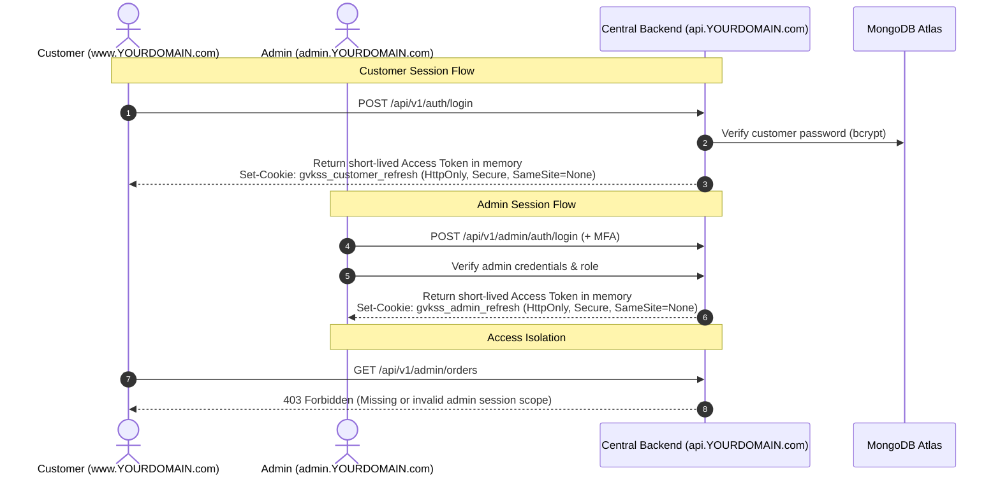
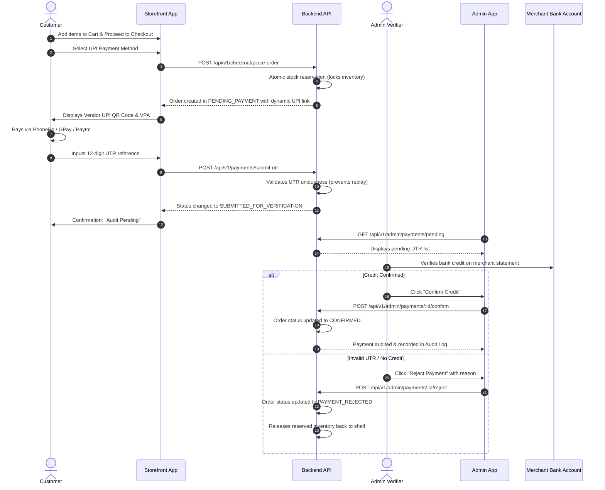
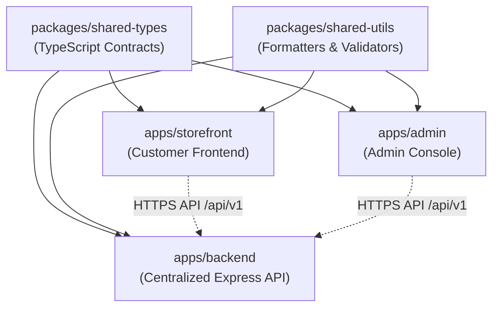

# GVKSS Organics - Production Target Architecture & System Blueprint

## 1. System Overview & Monorepo Layout

The GVKSS Organic E-Commerce platform is architected as an enterprise-grade, high-security monorepo separating customer-facing retail, administrative operations, and the central API service while operating over a unified MongoDB Atlas transactional cluster.

```
Organic-Products-Website/
│
├── apps/
│   ├── storefront/             # Customer-Facing SPA (React 19 + Vite + Tailwind)
│   │   ├── src/                # Bilingual catalog, Cart, Checkout, Order Tracking
│   │   ├── vercel.json         # SPA fallback rewrite rules
│   │   └── package.json        # Port 5173
│   │
│   ├── admin/                  # Administrative Operations SPA (React 19 + Vite + Tailwind)
│   │   ├── src/                # UPI Verification Desk, Orders, Products, Inventory Ledger
│   │   ├── vercel.json         # SPA fallback rewrite rules
│   │   └── package.json        # Port 5174
│   │
│   └── backend/                # Centralized Express API (Node.js + TypeScript + Mongoose)
│       ├── src/                # Modular domain services, controllers, middlewares, routes
│       ├── dist/               # Compiled JavaScript bundle
│       └── package.json        # Port 5000
│
├── packages/
│   ├── shared-types/           # Shared TypeScript domain contracts (Product, Order, etc.)
│   └── shared-utils/           # Shared utilities (formatINR, formatDate, isValidUTR)
│
├── docs/
│   ├── ARCHITECTURE.md         # System blueprint, security boundaries, and data flow
│   ├── API_DOCUMENTATION.md    # OpenAPI / Swagger and endpoint specifications
│   ├── DATABASE_SCHEMA.md      # Mongoose schemas, indexes, and transactional safeguards
│   └── DEPLOYMENT_GUIDE.md     # Production deployment instructions for Vercel and Render
│
├── ARCHITECTURE_AUDIT.md       # Pre-migration audit, security assessment, and findings
├── package.json                # Root workspaces orchestrator
└── README.md                   # Operational quickstart and repo overview
```

---

## 2. Multi-Subdomain Production Topology

Each layer is independently deployed with dedicated scaling, failure isolation, and zero cross-bundle contamination:

| Application | Production Subdomain | Dev Port | Deployment Target | Responsibilities |
| :--- | :--- | :--- | :--- | :--- |
| **Storefront** | `https://www.YOURDOMAIN.com` | `5173` | **Vercel** | Public product browsing, Telugu/English bilingual display, shopping cart, customer registration, checkout, UPI QR preview, UTR submission, customer profile, and real-time order tracking. |
| **Admin Console** | `https://admin.YOURDOMAIN.com` | `5174` | **Vercel** | Dedicated operations console, staff login with MFA, dashboard KPI analytics, manual UPI bank statement verification desk, order lifecycle management, consignment tracking, catalog CRUD, atomic warehouse stock replenishment, and security audit trail. |
| **Central Backend API** | `https://api.YOURDOMAIN.com` | `5000` | **Render / AWS ECS** | Central Express API, MongoDB Atlas Mongoose connection, atomic inventory reservations, JWT signing, bcrypt password hashing, session rotation, Zod payload validation, and notification dispatches. |
| **Database** | *Internal Atlas Replica Set* | `27017` | **MongoDB Atlas** | Distributed replica set with multi-document ACID transactions, unique indexes, and audit log persistence. |

---

## 3. Cross-Subdomain Authentication & Session Isolation

To guarantee that customer sessions cannot be abused to gain administrative privileges, and to allow concurrent administrator and customer sessions on separate browser tabs, session authentication uses partitioned cookie namespaces:



### Security Safeguards Implemented:
1. **Access Tokens in Memory:** Tokens expire in 15 minutes and are kept strictly in memory closures (`accessTokenMemory` / `adminAccessTokenMemory`). No long-lived sensitive tokens reside in `localStorage` or `sessionStorage` (preventing XSS exfiltration).
2. **HttpOnly Refresh Cookies:** Refresh tokens are signed, hashed in the database, and transmitted with `HttpOnly; Secure; SameSite=None; Path=/api/v1`.
3. **Dedicated Namespaces:** Storefront uses `gvkss_customer_refresh`; Admin portal uses `gvkss_admin_refresh`. Even on a shared machine, admin privileges cannot leak into customer workflows.
4. **Automatic Silent Refresh:** Both frontends intercept 401 responses and seamlessly issue refresh requests behind the scenes without disrupting user activity.
5. **Session Revocation:** On logout or password update, the active session is immediately revoked and blacklisted in `user_sessions`.

---

## 4. End-to-End Business Workflows

### 4.1 Manual UPI QR Verification Workflow



### 4.2 Cash on Delivery (COD) Workflow

1. Customer selects **Cash on Delivery** at checkout.
2. Backend verifies COD availability (`storeSettings.codEnabled === true`).
3. Backend performs atomic stock reservation and creates order in `CONFIRMED` status with `paymentStatus: 'pending'`.
4. Order appears immediately in Admin Order Manager for fulfillment and dispatch.
5. Delivery agent collects physical cash upon package handover.
6. Admin updates order status to `DELIVERED`, which marks `paymentStatus: 'confirmed'`.

---

## 5. Role-Based Access Control (RBAC) Matrix

| Permission / Operation | SUPER_ADMIN | ADMIN | ORDER_MANAGER | PAYMENT_VERIFIER | INVENTORY_MANAGER |
| :--- | :---: | :---: | :---: | :---: | :---: |
| **View Dashboard KPI Metrics** | ✅ | ✅ | ✅ | ✅ | ✅ |
| **Verify / Confirm UPI Payments** | ✅ | ✅ | ❌ | ✅ | ❌ |
| **Reject UPI Payments (with reason)** | ✅ | ✅ | ❌ | ✅ | ❌ |
| **Update Order Fulfillment Status** | ✅ | ✅ | ✅ | ❌ | ❌ |
| **Update Consignment Tracking Details** | ✅ | ✅ | ✅ | ❌ | ❌ |
| **Catalog CRUD (Add/Edit Products)** | ✅ | ✅ | ❌ | ❌ | ✅ |
| **Replenish Stock / Add to Ledger** | ✅ | ✅ | ❌ | ❌ | ✅ |
| **Modify Business / UPI Settings** | ✅ | ✅ | ❌ | ❌ | ❌ |
| **Manage Staff / Admin Users** | ✅ | ❌ | ❌ | ❌ | ❌ |
| **View Security Audit Trail** | ✅ | ✅ | ❌ | ❌ | ❌ |

---

## 6. Monorepo Dependency Flow


