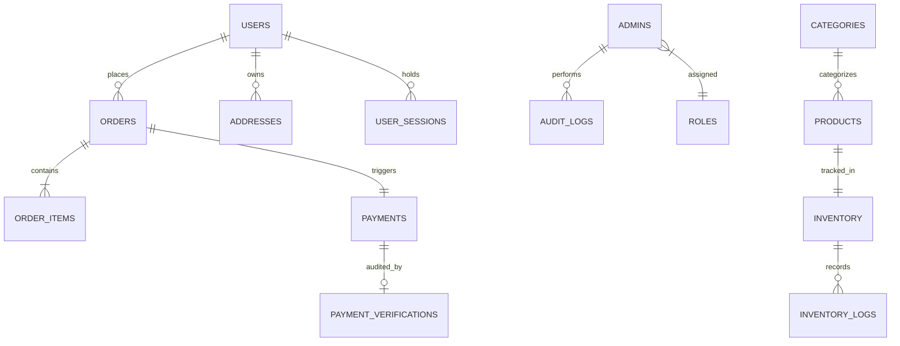

# GVKSS Organics - Database Architecture & Schema Specification

**Engine:** MongoDB Atlas Distributed Replica Set  
**Object Data Modeling (ODM):** Mongoose 8.x  
**Transaction Support:** Multi-Document ACID Transactions enabled across all orders, payments, and stock reservations.

---

## 1. Schema Entity Relationship Model



---

## 2. Collection Specifications

### 2.1 `users` (Customer Accounts)
Stores public customer credentials, contact details, and account health.

| Field | Type | Validation / Indexes | Description |
| :--- | :--- | :--- | :--- |
| `_id` | ObjectId | Primary Key | Unique customer identifier |
| `name` | String | Trimmed, required | Full customer name |
| `email` | String | Lowercase, unique index | Primary login email |
| `passwordHash` | String | Required | Bcrypt salted hash (cost factor: 12) |
| `phone` | String | Index | 10-digit Indian phone number |
| `isVerified` | Boolean | Default: false | Email verification flag |
| `status` | String | Enum: `active`, `suspended` | Account moderation status |
| `createdAt` | Date | Timestamp | Registration date |
| `updatedAt` | Date | Timestamp | Last profile update |

### 2.2 `admins` (Privileged Administrative Staff)
Isolated from the `users` collection to prevent privilege escalation.

| Field | Type | Description |
| :--- | :--- | :--- |
| `_id` | ObjectId | Primary Key |
| `email` | String | Unique index, lowercase |
| `passwordHash` | String | Bcrypt hash |
| `name` | String | Display name |
| `roleId` | ObjectId | Ref: `roles` |
| `mfaEnabled` | Boolean | Multi-Factor Authentication requirement |
| `mfaSecret` | String | Encrypted TOTP secret |
| `status` | String | Enum: `active`, `suspended` |
| `lastLogin` | Date | Timestamp |

### 2.3 `products` (Organic Catalog)

| Field | Type | Indexes | Description |
| :--- | :--- | :--- | :--- |
| `_id` | ObjectId | Primary Key | Unique product ID |
| `name` | String | Text index, required | English commercial name |
| `teluguName` | String | Telugu font string | Local vernacular name |
| `slug` | String | Unique index | SEO URL slug |
| `category` | String | Index | Category identifier (e.g. `millets`) |
| `price` | Number | Required, Min: 0 | Current selling price in INR |
| `discountedPrice` | Number | Optional | Original MRP / strikethrough price |
| `sku` | String | Unique index | Stock Keeping Unit |
| `quantity` | String | e.g. "1 kg", "500 ml" | Package size |
| `unit` | String | e.g. "kg", "pack" | Standard unit |
| `image` | String | URL | Cloudinary or verified CDN image |
| `description` | String | Markdown text | Health benefits & culinary details |
| `inStock` | Boolean | Index, default: true | Shelf visibility toggle |
| `isFeatured` | Boolean | Index | Frontpage showcase flag |

### 2.4 `inventory` & `inventory_logs` (Stock Ledgers)
Enforces atomic operations to prevent overselling.

```typescript
interface InventoryDocument {
  productId: ObjectId;        // Unique index, Ref: products
  stockQuantity: number;      // Total units in physical storage
  reservedStock: number;      // Units locked in active checkout
  availableStock: number;     // stockQuantity - reservedStock
  minThreshold: number;       // Low-stock warning trigger (e.g. 10)
  updatedAt: Date;
}
```

**Atomic Reservation Pattern:**
```typescript
await Inventory.updateOne(
  { productId, stockQuantity: { $gte: quantity } },
  { 
    $inc: { stockQuantity: -quantity, reservedStock: quantity } 
  },
  { session }
);
```

### 2.5 `orders` (Order Lifecycle)

| Field | Type | Indexes | Description |
| :--- | :--- | :--- | :--- |
| `_id` | ObjectId | Primary Key | Order record identifier |
| `orderNumber` | String | Unique index | Human-readable identifier (e.g. `GVK-782120`) |
| `customerId` | ObjectId | Index, Ref: `users` | Authenticated customer |
| `customerName` | String | Required | Customer name at time of purchase |
| `phone` | String | Required | Delivery contact number |
| `deliveryAddress` | String | Required | Full street address and pincode |
| `items` | Array | Nested schema | Product snapshots (price locked at checkout) |
| `subtotal` | Number | In INR | Sum of product prices |
| `deliveryFee` | Number | In INR | Calculated shipping charge |
| `totalAmount` | Number | In INR | Total payable amount |
| `paymentMethod` | String | Enum: `upi`, `cod` | Chosen payment channel |
| `paymentStatus` | String | Enum: `pending`, `submitted`, `confirmed`, `rejected` | Payment verification state |
| `orderStatus` | String | Enum: `pending`, `confirmed`, `shipped`, `delivered`, `cancelled` | Fulfillment stage |
| `trackingNumber` | String | Optional | Courier waybill reference |
| `courierPartner` | String | Optional | Logistics provider (DTDC, Delhivery) |
| `createdAt` | Date | Compound index `(createdAt: -1, orderStatus: 1)` | Order placement time |

### 2.6 `payments` & `payment_verifications`

| Field | Type | Description |
| :--- | :--- | :--- |
| `_id` | ObjectId | Primary Key |
| `orderId` | ObjectId | Ref: `orders`, unique index |
| `paymentMethod` | String | `upi` or `cod` |
| `amount` | Number | Verified monetary amount |
| `utrNumber` | String | **Unique index, sparse** (Prevents UTR replay attacks) |
| `paymentStatus` | String | `pending` -> `submitted` -> `confirmed` / `rejected` |
| `submittedAt` | Date | Customer submission time |
| `verifiedBy` | ObjectId | Ref: `admins` (Audited staff member) |
| `verifiedAt` | Date | Verification timestamp |
| `rejectionReason` | String | Recorded reason if payment was denied |

### 2.7 `audit_logs` (Security Event Trail)
Immutable ledger capturing staff operations.

| Field | Type | Description |
| :--- | :--- | :--- |
| `_id` | ObjectId | Event identifier |
| `action` | String | Enum (e.g. `PAYMENT_CONFIRMED`, `STOCK_ADDED`) |
| `adminId` | ObjectId | Ref: `admins` |
| `adminEmail` | String | Snapshot of admin user email |
| `targetEntity` | String | Target resource (e.g. Order #, Product ID) |
| `ipAddress` | String | Client remote IP |
| `userAgent` | String | Browser agent string |
| `timestamp` | Date | Default: `Date.now` (Indexed for 90-day retention) |

---

## 3. Database Indexes Summary

```javascript
// High-performance compound & unique indexes
db.users.createIndex({ email: 1 }, { unique: true });
db.admins.createIndex({ email: 1 }, { unique: true });
db.orders.createIndex({ orderNumber: 1 }, { unique: true });
db.orders.createIndex({ customerId: 1, createdAt: -1 });
db.orders.createIndex({ orderStatus: 1, createdAt: -1 });
db.payments.createIndex({ utrNumber: 1 }, { unique: true, sparse: true });
db.inventory.createIndex({ productId: 1 }, { unique: true });
db.audit_logs.createIndex({ createdAt: -1 });
```

---

## 4. Preservation & Migration Safeguards

1. **No Database Reset:** The production database will NOT be dropped or reset. Existing `users`, `products`, and `orders` records are preserved verbatim.
2. **Backward-Compatible Schemas:** New fields (such as `reservedStock`, `mfaEnabled`, `trackingNumber`) have safe default fallbacks.
3. **Transaction Rollbacks:** Any exception during multi-step order placement rolls back atomic stock reservations and order creation cleanly.
